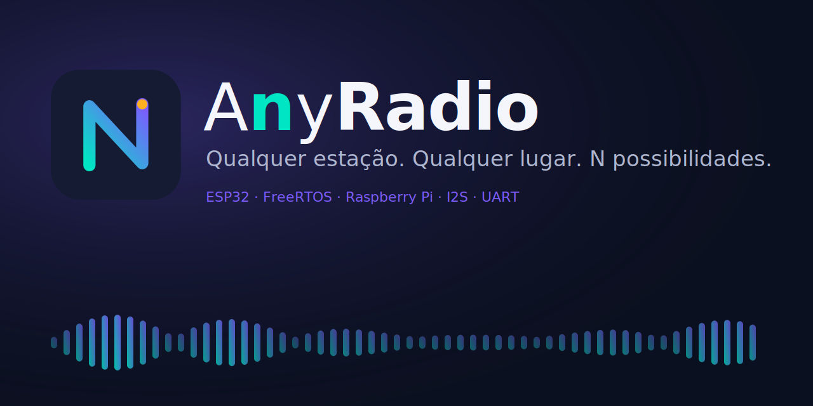

<p align="center">
  
</p>

<p align="center">
  
  
  
  
  
</p>

<h3 align="center">Qualquer estação. Qualquer lugar. <em>N</em> possibilidades.</h3>

---

## O que é

**AnyRadio** é um rádio de internet feito do zero, em que você **vê o sistema operacional trabalhando enquanto a música toca**.

O nome tem um truque: *Any* soa como **N**. Na matemática, *n* é "qualquer número"; no rádio, é qualquer estação. Por isso o **N** é o símbolo da marca: um zigue-zague que é, ao mesmo tempo, a letra e um sinal viajando.

- **O ESP32 é o rádio.** Conecta no Wi-Fi, baixa o stream, decodifica o MP3 e toca por I2S, tudo em tempo real com **FreeRTOS**.
- **O Raspberry Pi é a cara dele.** Mostra estação, volume, VU meter e um **monitor do RTOS ao vivo** numa tela de 5".
- **Controle físico.** Encoder rotativo e botões para trocar de estação e ajustar o volume, sem engasgar o som.

> **Regra de ouro:** o Pi **nunca** toca o áudio. Toda a lógica de tempo real fica no ESP32; entre os dois só passam mensagens pela UART.

## Para que serve

| Para quem | O que entrega |
| :-- | :-- |
| Quem quer ouvir rádio | Um rádio de internet de verdade, com tela e botões |
| Quem estuda sistemas embarcados | Cada conceito de FreeRTOS visto em aula acontecendo na tela, ao vivo |
| Quem quer aprender integração | Dois computadores de natureza diferente conversando por um protocolo simples |

## Arquitetura

```mermaid
flowchart LR
    NET([Internet<br/>stream MP3]) -->|Wi-Fi| ESP
    subgraph ESP[ESP32 · FreeRTOS · tempo real]
        direction TB
        NETT[Task de rede<br/>produtora] -->|Stream Buffer| AUD[Task de áudio<br/>consumidora]
        IN[Task de entrada] --> Q[(Fila de comandos)]
        ISR{{ISR encoder e botões}} -->|Semáforo| IN
        TEL[Task de telemetria<br/>200 ms]
    end
    AUD -->|I2S| AMP[MAX98357A] --> SPK([Alto-falante])
    ENC([Encoder + botões]) --> ISR
    ESP <-->|UART · JSON · 115200 baud| PI
    subgraph PI[Raspberry Pi · interface]
        direction TB
        BE[Node.js + serialport] -->|WebSocket| FE[React no Chromium kiosk]
    end
    FE --> LCD([Tela HDMI 5"])
```

## Tecnologias

| Camada | Tecnologia | Função |
| :-- | :-- | :-- |
| Firmware | **ESP-IDF** (ou PlatformIO/Arduino com o core do ESP32) | Ambiente de desenvolvimento do ESP32 |
| Firmware | **FreeRTOS** | Tasks, filas, semáforos, mutex e stream buffer |
| Firmware | **ESP32-audioI2S** | Stream HTTP e decodificação de áudio |
| Áudio | **I2S + MAX98357A** | DAC e amplificador digital, saída para o alto-falante |
| Comunicação | **UART · JSON por linha** | Telemetria e comandos entre ESP32 e Pi |
| Interface | **Node.js + serialport** | Backend que lê a serial no Pi |
| Interface | **WebSocket** | Repassa as mensagens do backend para a tela |
| Interface | **React + Chromium (modo kiosk)** | Telas "Tocando agora" e "Monitor do RTOS" |
| Sistema | **Raspberry Pi OS (desktop)** | Roda a interface |
| Simulação | **Wokwi** | Testa tasks, filas e semáforos antes do hardware chegar |
| Organização | **GitHub** | Código, issues e documentação |

## Métodos: o FreeRTOS no AnyRadio

Cada recurso visto em aula tem um lugar natural no rádio.

| Recurso | Onde aparece | API principal |
| :-- | :-- | :-- |
| Tasks e prioridades | Rede, áudio, entrada, telemetria e comunicação; o áudio tem a maior prioridade | `xTaskCreatePinnedToCore` |
| Produtor-consumidor | A task de rede enche o buffer, a de áudio esvazia | `xStreamBufferSend` / `xStreamBufferReceive` |
| Fila | Comandos do usuário (encoder, botões, touch) até quem executa | `xQueueSend` / `xQueueReceive` |
| Semáforo binário | A ISR do encoder acorda a task de entrada | `xSemaphoreGiveFromISR` / `xSemaphoreTake` |
| Mutex | Protege o estado (estação, volume) e a UART de saída | `xSemaphoreCreateMutex` |
| Fila de eventos do driver | O driver UART entrega os dados recebidos do Pi | `uart_driver_install` |
| Tarefa periódica | Telemetria a cada 200 ms, sem acumular atraso | `vTaskDelayUntil` |
| Event group *(extra)* | Espera Wi-Fi conectado e buffer pronto antes de tocar | `xEventGroupWaitBits` |
| Estatísticas do sistema | Alimenta a tela de monitor do RTOS | `uxTaskGetSystemState` |

> Para `uxTaskGetSystemState` funcionar, ative `configUSE_TRACE_FACILITY` e `configGENERATE_RUN_TIME_STATS` no `menuconfig`.

## Protocolo UART

Uma linha JSON por mensagem, terminada em `\n`, a **115200 baud**. Dá para ler tudo direto num terminal serial.

**Ligação:** TX do ESP32 → RX do Pi (GPIO15, pino 10) · RX do ESP32 ← TX do Pi (GPIO14, pino 8) · GND com GND. Os dois operam em 3,3 V, sem conversor de nível.

| Direção | Tipo | Exemplo |
| :-- | :-- | :-- |
| ESP32 → Pi | Status (a cada 200 ms) | `{"t":"status","st":"Rádio X","vol":12,"buf":78,"rssi":-61}` |
| ESP32 → Pi | VU meter | `{"t":"vu","l":34,"r":40}` |
| ESP32 → Pi | Monitor do RTOS (a cada 1 s) | `{"t":"rtos","tasks":[{"n":"audio","s":"R","cpu":41,"stk":812}],"q":{"cmd":2}}` |
| ESP32 → Pi | Evento | `{"t":"evt","e":"wifi_lost"}` |
| Pi → ESP32 | Trocar estação | `{"cmd":"station","i":3}` |
| Pi → ESP32 | Volume | `{"cmd":"vol","v":13}` |
| Pi → ESP32 | Play/pause | `{"cmd":"toggle"}` |

## Hardware

| Componente | Para que serve |
| :-- | :-- |
| ESP32 (de preferência WROVER, com PSRAM) | Wi-Fi, stream, decodificação e FreeRTOS |
| Raspberry Pi 3 ou 4 + microSD 16 GB+ | Roda a interface |
| Tela 5" HDMI | Interface do rádio |
| Módulo MAX98357A | DAC + amplificador I2S |
| Alto-falante 4–8 Ω, ~3 W | Saída de áudio |
| Encoder rotativo KY-040 | Volume e estação (gera interrupções) |
| 2–3 botões táteis | Play/pause, próxima e anterior |
| Capacitor 470–1000 µF | Estabiliza a alimentação do amplificador |
| Fontes 5 V / 3 A (Pi) e 5 V / 2 A (ESP32) | Alimentação |
| Protoboard + jumpers | Montagem, incluindo 3 fios para a UART |

## Estrutura do repositório

```
anyradio/
├── firmware/     # ESP32: FreeRTOS, áudio, entradas, UART
├── ui/           # Raspberry Pi: backend Node + front-end React
├── docs/         # Guia do projeto, diagramas, slides
├── images/       # Logo, banner e identidade visual
└── README.md
```

## Como rodar

> Os comandos abaixo são o ponto de partida; ajuste conforme o projeto for tomando forma.

**Firmware (ESP32)**

```bash
cd firmware
idf.py set-target esp32
idf.py build
idf.py -p [PORTA_SERIAL] flash monitor
```

**Interface (Raspberry Pi)**

```bash
cd ui
npm install
npm start        # [ajustar conforme os scripts do package.json]
```

Antes, no Pi: ative a UART (`raspi-config` → Interface → Serial: console **desligado**, hardware **ligado**) e configure o Chromium para abrir em modo kiosk no boot.

## Roadmap

- [ ] **Fase 0:** Preparação (repositório, ambiente, esqueleto no Wokwi)
- [ ] **Fase 1:** Raspberry Pi e tela
- [ ] **Fase 2:** Áudio no ESP32 (I2S, Wi-Fi, tasks de rede e áudio)
- [ ] **Fase 3:** Entradas (encoder, botões, fila, mutex)
- [ ] **Fase 4:** Comunicação ESP32 ↔ Pi
- [ ] **Fase 5:** Interface (Tocando agora + Monitor do RTOS + kiosk)
- [ ] **Fase 6:** Montagem final e apresentação

## Demonstrações

A ideia é mostrar cada conceito acontecendo na tela, não só o rádio tocando:

1. **ISR e semáforo:** girar o encoder e ver a task de entrada sair de *Blocked* para *Running*.
2. **Produtor-consumidor:** derrubar o Wi-Fi; o buffer cai, o som continua por um tempo e só depois corta.
3. **Mutex:** UART sem mutex (mensagens embaralhadas) contra UART com mutex (tudo limpo).
4. **Prioridades:** baixar a prioridade da task de áudio e ver o som engasgar.

## Equipe

- Irvin Amilcar
- Júlia Torres
- Matheus Martins
- Vinícius Marques

## Licença

[Definir licença, ex.: MIT]

---

<p align="center"><sub>Feito com FreeRTOS, café e um N que vale por qualquer estação.</sub></p>
